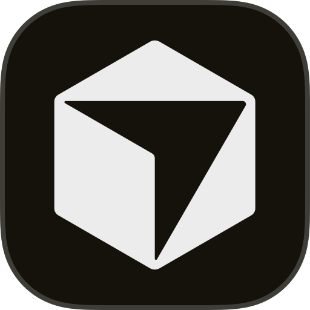
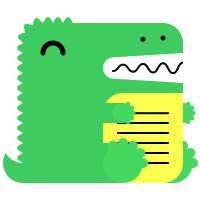
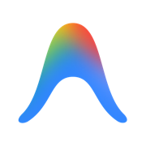
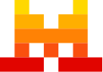
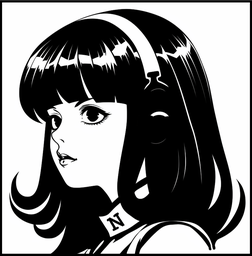
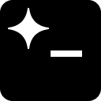

# Agent YOLO

Agent YOLO is an AI-agent extender that brings a unified "YOLO panel" for AI coding agents
(Cursor, Claude, Codex, and many more) into your IDE.
It is available across three IDE families — JetBrains, Visual Studio, and Visual Studio Code.

## Agent YOLO Family

  

  
  &nbsp;&nbsp;&nbsp;
  
  &nbsp;&nbsp;&nbsp;
  

| Product | Platform | Marketplace |
| --- | --- | --- |
| **Agent YOLO for IntelliJ** | JetBrains (IntelliJ IDEA and other IntelliJ-based IDEs) | [JetBrains Marketplace](https://plugins.jetbrains.com/plugin/33442-agent-yolo/) |
| **Agent YOLO for Visual Studio** | Microsoft Visual Studio | [Visual Studio Marketplace](https://marketplace.visualstudio.com/items?itemName=CnSharpStudio.yolo) |
| **Agent YOLO for Visual Studio Code** | Visual Studio Code | [Visual Studio Marketplace](https://marketplace.visualstudio.com/items?itemName=cnsharp.agentyolo) |

## Repositories

| Product | GitHub Repository |
| --- | --- |
| Agent YOLO for IntelliJ | https://github.com/cnsharp/YOLO-IntelliJ |
| Agent YOLO for Visual Studio | https://github.com/cnsharp/YOLO-VS |
| Agent YOLO for Visual Studio Code | https://github.com/cnsharp/YOLO-VSC |

> **Related:** [`ai-agents-terminal-vsc`](https://github.com/cnsharp/ai-agents-terminal-vsc) is a side project that provides a Terminal Agent Launcher on the status bar, and serves as the upstream of *Agent YOLO for Visual Studio Code* (YOLO-VSC is a fork of it). Agent and resource changes on the VS Code side should be made in `ai-agents-terminal-vsc` first, then ported to YOLO-VSC.

## Supported agents

The agent list below is shared across the whole **Agent YOLO** family (IntelliJ, Visual Studio, and VS Code editions). It is generated from `agents.json` in the [YOLO-VS](https://github.com/cnsharp/YOLO-VS) repository — that file is the single source of truth, so new or changed agents are added there and synced to the other editions. Any agent not listed works as a custom tool: configure it in the IDE settings and fill in its flags yourself.

| id | display name | command | website |
|---|---|---|---|
| claude | Claude Code | `claude` |  |
| codex | Codex | `codex` |  |
| cursor | Cursor | `agent` |  |
| copilot | GitHub Copilot | `copilot` |  |
| opencode | OpenCode | `opencode` |  |
| aider | Aider | `aider` |  |
| cline | Cline | `cline` |  |
| continue | Continue | `cn` |  |
| openclaw | OpenClaw | `openclaw` |  |
| kiro | Kiro | `kiro-cli` |  |
| goose | Goose | `goose` |  |
| crush | Charm Crush | `crush` |  |
| amp | Amp | `amp` |  |
| kimi | Kimi | `kimi` |  |
| qwen-code | Qwen Code | `qwen` |  |
| trae | TraeCode | `traecli` |  |
| codebuddy | CodeBuddy | `codebuddy` |  |
| qoder | Qoder | `qoder` |  |
| devin | Devin | `devin` |  |
| grok | Grok | `grok` |  |
| antigravity | Antigravity | `agy` |  |
| mistral-vibe | Mistral Vibe | `vibe` |  |
| kilo | Kilo Code | `kilo` |  |
| hermes | Hermes | `hermes` |  |
| pi | Pi | `pi` |  |
| droid | Droid | `droid` |  |
| aug | Auggie | `auggie` |  |
| rovo | Rovo Dev | `rovo` |  |
| prime-agent | Prime Agent | `prime-agent` |  |
| autohand | Autohand | `autohand` |  |
| command-code | Command Code | `command-code` |  |
| ante | Ante | `ante` |  |
| codebuff | Codebuff | `codebuff` |  |
| omp | OMP | `omp` |  |
| agoragentic | Agoragentic | `agoragentic-mcp` |  |
| cortex-code | Cortex Code | `cortex` |  |
| corust-agent | Corust Agent | `corust` |  |
| crow-cli | Crow CLI | `crow-cli` |  |
| deepagents | DeepAgents | `deepagents-acp` |  |
| dirac | Dirac | `dirac` |  |
| dimcode | DimCode | `dim` |  |
| fast-agent | Fast Agent | `fast-agent` |  |
| glm-agent | GLM Agent | `glm-acp-agent` |  |
| harn | Harn | `harn` |  |
| junie | Junie | `junie` |  |
| minion-code | Minion Code | `minion-code` |  |
| nova | Nova | `nova` |  |
| poolside | Poolside | `pool` |  |
| sigit | siGit Code | `sigit` |  |
| stakpak | Stakpak | `stakpak` |  |
| vtcode | VT Code | `vtcode` |  |
